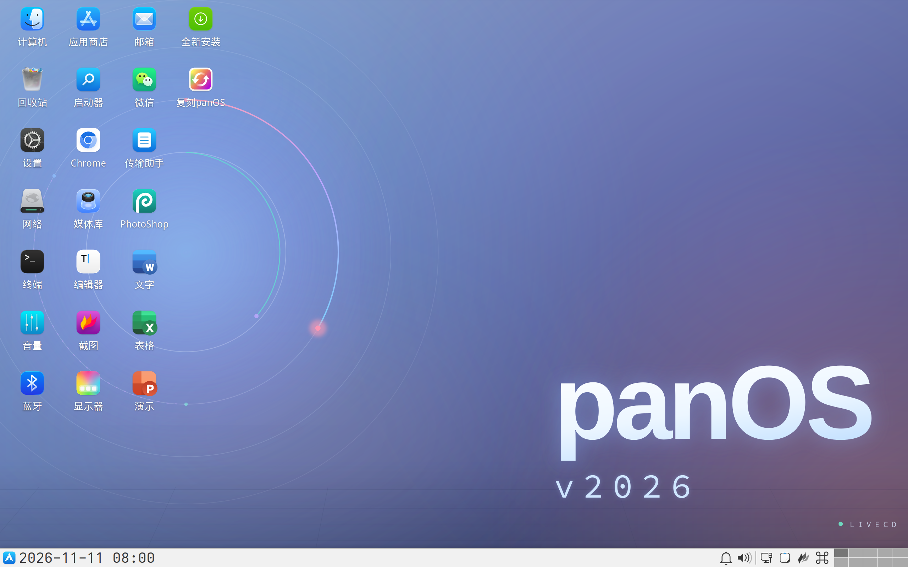
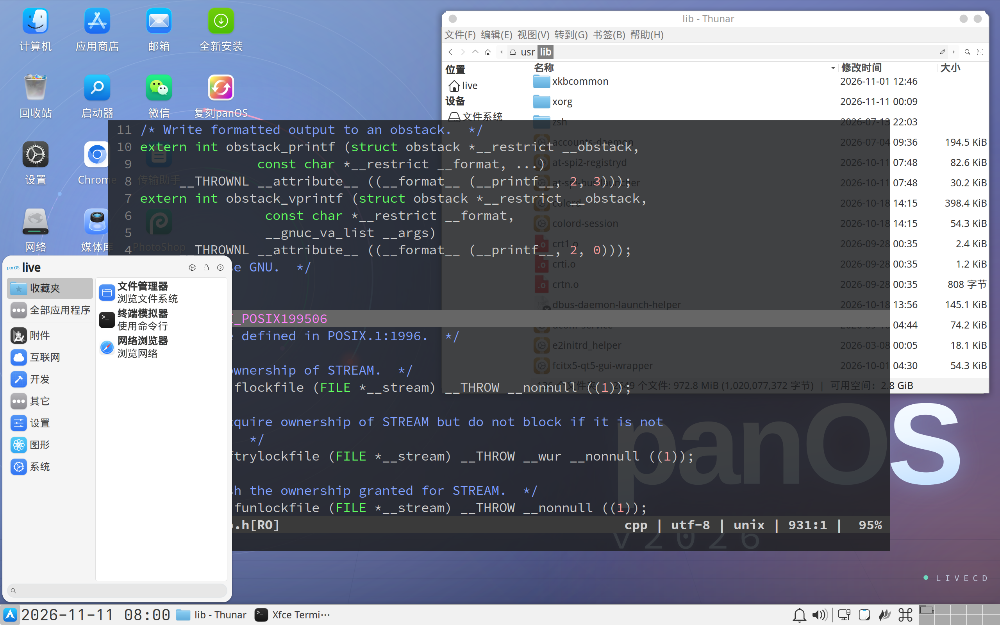
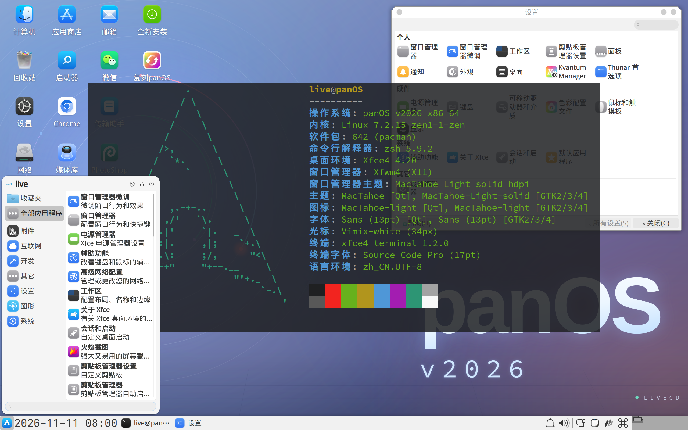

# panOS v2026

English | [简体中文]

[简体中文]: README.md

> This project is essentially production-ready. The ISO will only be updated from time to time to keep base components current.

## Download

- [Releases · kitty-panics/panOS_v2026]

[Releases · kitty-panics/panOS_v2026]: https://github.com/kitty-panics/panOS_v2026/releases

## Features

- Around 1GB — smaller than Arch's official TTY ArchISO (Lite ISO).
- Built from the [Testing repo], rolls and updates regularly.
- Boots in both BIOS and UEFI, plug and play.
- Ships with Xfce4 — clean and minimal, adapts to any screen resolution.
- Chinese fonts and input methods preconfigured — ready to go for Chinese users.
- Bundles all sorts of maintenance tools — boot, performance, disk, network, logs, and more.
- A hand-picked set of online apps, enough for light use and office work.
- VirtualBox + VMware guest additions built in — smoother in VMs.
- Comes with the [Linyaps App Store] for installing various domestic apps on the fly.
- Tencent [CodeBuddy Code] integration — type codebuddy / cbc in your terminal to launch it.
- Shortcuts kept close to Windows so it feels familiar.

[Testing repo]: https://wiki.archlinux.org/title/Official_repositories#Testing_repositories
[Linyaps App Store]: https://store.linyaps.org.cn/
[CodeBuddy Code]: https://www.codebuddy.cn/

## Usage

#### 1. Username is the password.

> SSH is on by default — you can connect with a password.

- User: `live`, password: `live`.
- User: `root`, password: `root`.

#### 2. Input method is `fcitx5 + rime`, with full Pinyin (Simplified Chinese) installed.

- `Ctrl + Space` to switch between Chinese and English.
- `Ctrl + ;` to open the clipboard.

#### 3. Use `run` instead of `sudo` so you don't have to type a password.

## Installation

- For a fresh Arch Linux install, click the **全新安装** desktop icon — it runs `archinstall` and walks you through it.
- To keep using panOS v2026 as a base, click the **复刻panOS** desktop icon — a detailed doc pops up to walk you through it.

## Docs

- [系统概览](docs/01-overview.md)
- [桌面环境](docs/02-desktop.md)
- [系统快捷键](docs/03-shortcuts.md)
- [内置应用](docs/04-apps.md)
- [自研脚本](docs/05-scripts.md)
- [输入法](docs/06-input.md)
- [软件包管理](docs/07-packages.md)
- [安装与复刻](docs/08-install.md)
- [系统维护](docs/09-maintenance.md)
- [配置文件参考](docs/10-config.md)
- [应用内快捷键](docs/11-app-keys.md)
- [软件包清单](docs/12-packages-list.md)

## v2027 Plans

- [ ] ~~Move the base to Debian Sid.~~
- [ ] Plugin support, so you can sideload more apps without growing the ISO.
- [X] More built-in maintenance tools, covering more scenarios.
- [ ] Full switch to Wayland (Waiting for [Xfce Wayland] to become available).

[Xfce Wayland]: https://wiki.xfce.org/releng/wayland_roadmap

## Screenshot

