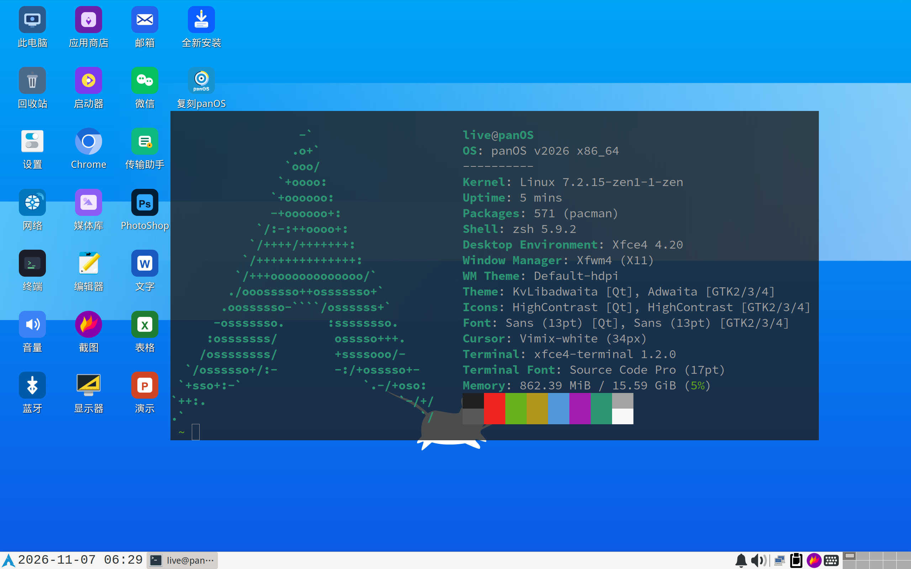

# panOS v2026

[English] | 简体中文

[English]: README.md

> 本项目已基本达到生产可用状态，后续仅不定期更新 ISO，以保持基础组件版本更新。

## 特性

- 镜像体积约 1GB，比 Arch 官方的 TTY ArchISO 更小。
- 基于 Testing 仓库构建，镜像定期滚动更新。
- 支持 BIOS / UEFI 双模启动，即插即用。
- 预装 Xfce4 桌面与常用维护工具，图形化排障，即时检索资料更方便。
- 界面清爽简约，能自适应各种屏幕分辨率。
- 精选常用应用在线版，可满足轻度使用和办公场景。
- 预配置中文字体与输入法，中文用户开箱即用。
- 集成 [如意玲珑应用商店]，可临时安装各类国产软件。
- 集成腾讯 CodeBuddy-Code，终端中输入 codebuddy / cbc 调用。
- 内置 VirtualBox + VMware 增强插件，虚拟机中使用更顺手。
- 常用快捷键尽量贴近 Windows，操作更熟悉。

[如意玲珑应用商店]: https://store.linyaps.org.cn/

## 使用

#### 1. 用户名即是密码。

> 默认启用 SSH 服务，可以通过密码连接。

- 用户: `live`，密码: `live`。
- 用户: `root`，密码: `root`。

#### 2. 输入法为 `fcitx5 + rime`，已安装全拼简体中文输入方案。

- 通过 `Ctrl + Space` 切换中英文输入法。
- 通过 `Ctrl + ;` 打开剪切板。

#### 3. `~/.local/.bin` 里面是个人定制的一些脚本。

#### 4. `~/ .local/.pkg/Fake` 里面是一些占位空包，用于减小 ISO 体积。

#### 5. 使用 `run` 命令代替 `sudo` 可免于输入密码。

## 下载

- [Releases · kitty-panics/panOS_v2026]

[Releases · kitty-panics/panOS_v2026]: https://github.com/kitty-panics/panOS_v2026/releases

## 安装

- 全新安装 Arch Linux，点击 "全新安装" 桌面图标，会调用 `archinstall` 命令引导你完成安装。
- 如果要在 panOS v2026 基础上继续使用，点击 "复刻panOS" 桌面图标，会弹出一篇详细文档引导你完成复刻。

## v2027 计划

- ~~底层使用 Debian Sid。~~
- 支持插件，可在不增加 ISO 体积的前提下侧载更多应用。
- 内置更多维护工具，尽量覆盖更多场景。
- 全面转向 Wayland。
