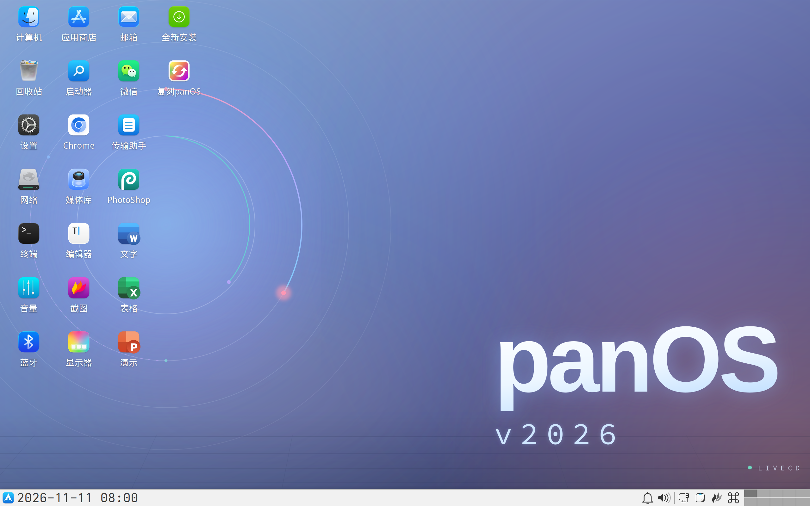
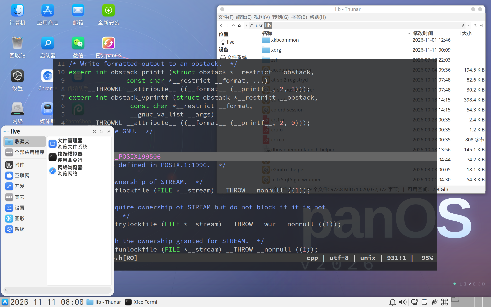
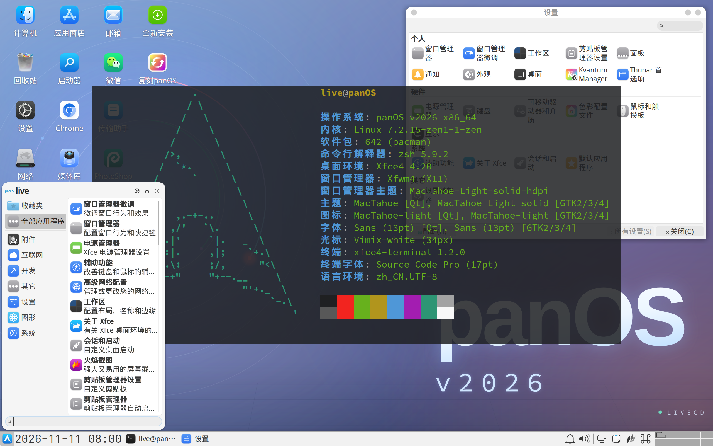

# panOS v2026

[English] | 简体中文

[English]: README-en.md

> 本项目已基本达到生产可用状态，后续仅不定期更新 ISO，以保持基础组件版本更新。

## 下载

- [Releases · kitty-panics/panOS_v2026]

[Releases · kitty-panics/panOS_v2026]: https://github.com/kitty-panics/panOS_v2026/releases

## 特性

- ~~镜像体积约 1GB，比 Arch 官方的 TTY ArchISO 更小。~~ (不再发布 Lite ISO)
- 基于 [Testing 仓库] 构建，镜像定期滚动更新。
- 支持 BIOS / UEFI 双模启动，即插即用。
- 预装 Xfce4 桌面，界面清爽简约，能自适应各种屏幕分辨率。
- 预配置中文字体与输入法，中文用户开箱即用。
- 包含引导、性能、磁盘、网络、日志... 等各种维护工具。
- 精选常用应用在线版，可满足轻度使用和办公场景。
- 内置 VirtualBox + VMware 增强插件，虚拟机中使用更顺手。
- 集成 [如意玲珑应用商店]，可临时安装各类国产软件。
- 集成腾讯 [CodeBuddy Code]，终端中输入 codebuddy / cbc 调用。
- 常用快捷键尽量贴近 Windows，操作更熟悉。

[Testing 仓库]: https://wiki.archlinux.org/title/Official_repositories#Testing_repositories
[如意玲珑应用商店]: https://store.linyaps.org.cn/
[CodeBuddy Code]: https://www.codebuddy.cn/

## 使用

#### 1. 用户名即是密码。

> 默认启用 SSH 服务，可以通过密码连接。

- 用户: `live`，密码: `live`。
- 用户: `root`，密码: `root`。

#### 2. 输入法为 `fcitx5 + rime`，已安装全拼简体中文输入方案。

- 通过 `Ctrl + Space` 切换中英文输入法。
- 通过 `Ctrl + ;` 打开剪切板。

#### 3. 使用 `run` 命令代替 `sudo` 可免于输入密码。

## 安装

- 全新安装 Arch Linux，点击 **全新安装** 桌面图标，会调用 `archinstall` 命令引导你完成安装。
- 如果要在 panOS v2026 基础上继续使用，点击 **复刻panOS** 桌面图标，会弹出一篇详细文档引导你完成复刻。

## 文档

- [系统概览](docs/01-overview.md)
- [桌面环境](docs/02-desktop.md)
- [系统快捷键](docs/03-shortcuts.md)
- [内置应用](docs/04-apps.md)
- [自研脚本](docs/05-scripts.md)
- [输入法](docs/06-input.md)
- [软件包管理](docs/07-packages.md)
- [安装与复刻](docs/08-install.md)
- [系统维护](docs/09-maintenance.md)
- [配置文件参考](docs/10-config.md)
- [应用内快捷键](docs/11-app-keys.md)
- [软件包清单](docs/12-packages-list.md)

## v2027 计划

- [ ] ~~底层使用 Debian Sid。~~
- [ ] 支持插件，可在不增加 ISO 体积的前提下侧载更多应用。
- [X] 集成更多维护工具，尽量覆盖更多场景。
- [ ] 全面转向 Wayland (等待 [Xfce Wayland] 可用)。

[Xfce Wayland]: https://wiki.xfce.org/releng/wayland_roadmap

## 界面预览

